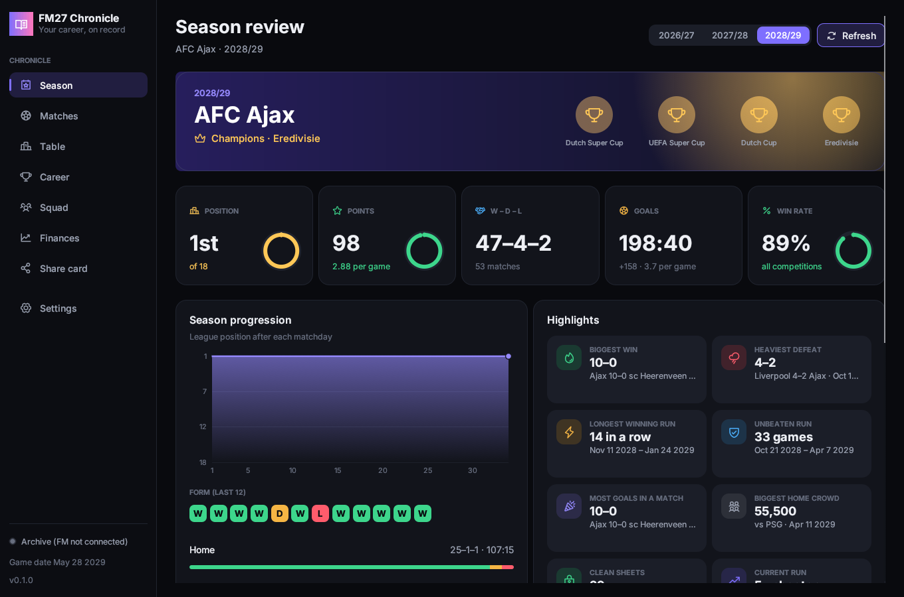
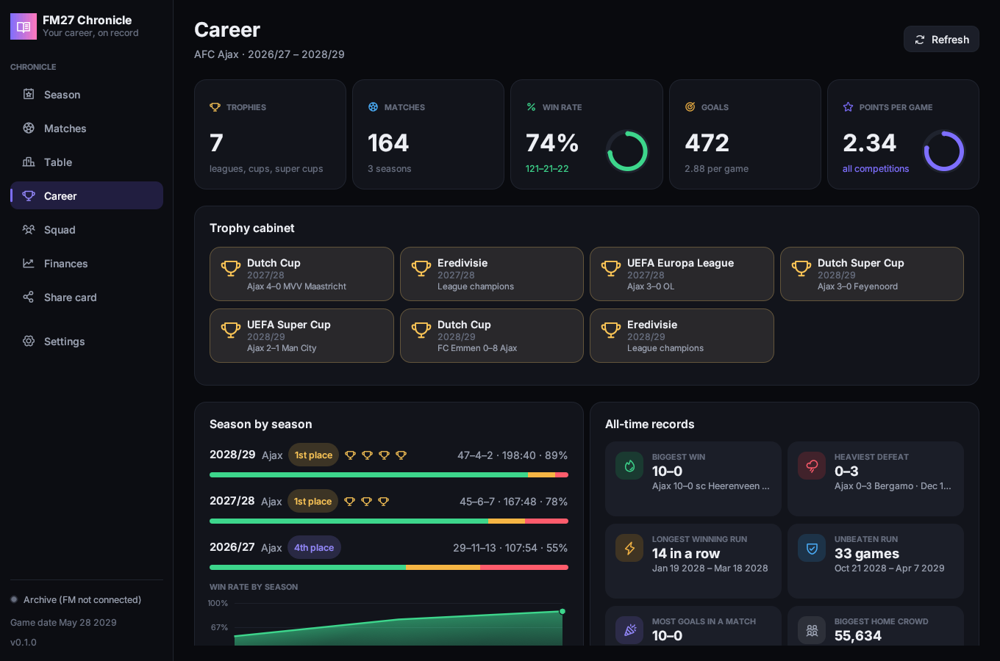
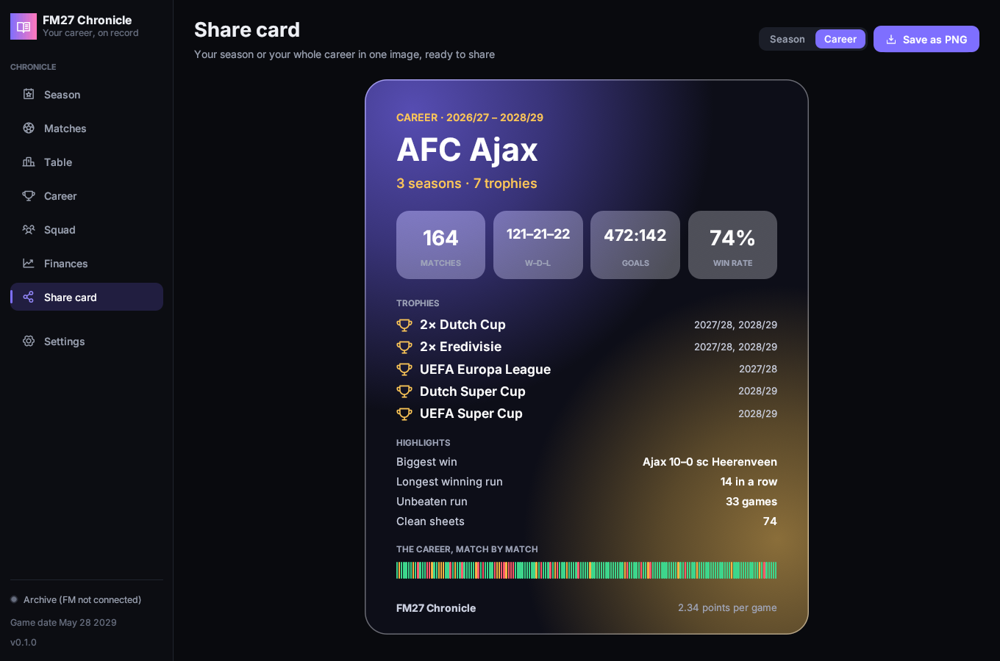

# FM27 Chronicle

Your Football Manager 27 career, on record. FM27 Chronicle reads your save live from the running game and builds
the season review FM27 itself no longer has: results, league tables, trophies, records and a share card.

It only reads. It never changes your save.

**Download:** [macOS (.dmg)](../../releases/latest/download/FM27-Chronicle-macOS.dmg) ·
[Windows (.zip)](../../releases/latest/download/FM27-Chronicle-Windows.zip)



| Career | Share card |
|---|---|
|  |  |

## What you get

- **Season review**: position, points, record, goals, win rate, league position after every matchday, form,
  highlights (biggest win, longest winning run, unbeaten run, biggest crowd, clean sheets), results per
  competition, goals by month and how far you got in every cup.
- **Matches**: every match of the season with competition, round, score, aggregate and attendance.
- **League table**: computed from every result in your league, for every season of the save.
- **Career**: trophy cabinet, season by season, all-time records, favourite opponent and bogey team. The
  career follows you as a manager: change clubs and your history stays, the new club is added.
- **Squad and finances**: squad value, player level, wages, balance and budgets, recorded every game week
  from the moment you start using the app.
- **Share card**: your season or your whole career in one image (PNG), ready to post.

Matches, competitions, rounds and finals go back to the first day of the save, because FM27 keeps them in
memory. Squad and finance history starts when the app first sees your save.

## How it connects

- **Windows**: start FM27 and load your save. The app reads `fm.exe` from outside.
- **macOS**: FM27 has to start with a small module (Settings → *Start FM27*). It is the same module
  [FM27 Trainer](https://github.com/SemHiel2003/fm27-trainer) uses, so if you started FM with FM27 Trainer,
  Chronicle connects by itself.

## Install

- **macOS**: download the .dmg, drag **FM27 Chronicle** to *Applications*. Signed and notarised. Save and quit
  FM27, click *Start FM27* in the app (Steam must be open) and load your save.
- **Windows**: download the .zip, unzip and run **FM27 Chronicle.exe**. The exe is not code-signed: if
  SmartScreen warns, click *More info → Run anyway*. Start FM27 as usual and load your save.

## Status

Version 0.1.0, first build. Read live on macOS (Apple silicon) with the Steam build of 17 November 2026.
**Windows is built but not tested yet**: if it does not find your matches there, please open an issue. Goalscorers and player appearances are not read (not found in memory yet).
The league table uses points, goal difference and goals scored; leagues with other tie-breakers can differ.

## Build

```
cargo test -p fm27-chronicle
cargo run -p fm27-chronicle
./bundle.sh            # macOS: dist/FM27 Chronicle.app (ad-hoc signed)
```

`fm27-chronicle dump file.json` writes everything the app reads as JSON; `FMC_DATA=file.json` shows that file
without FM running.

## Support

FM27 Chronicle is free and stays free. If you enjoy it and want to give something back, you can
[donate on Ko-fi](https://ko-fi.com/semhiel).

## Disclaimer

Independent fan project, not affiliated with Sports Interactive or SEGA. MIT licence.
